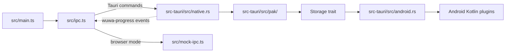

# Repository Guidelines

## Project Overview

WuwaID Mobile is a Tauri 2 companion for applying Indonesian localization to Wuthering Waves and customizing the displayed UID. The app combines a TypeScript/Vite UI with a Rust backend and Android Kotlin plugins. Browser mode uses a simulated backend; it does not exercise privileged Android storage operations.

## Architecture & Data Flow



- `src/model.ts` defines shared UI and command-result types; `src/main.ts` owns view state and user actions. Route native calls through the typed wrappers in `src/ipc.ts` and keep browser simulation in `src/mock-ipc.ts`.
- `src-tauri/src/lib.rs` registers Tauri commands and managed state. `native.rs` coordinates dashboard loading and operations; `pak/` contains shared release, installation, storage, and UID logic. `android.rs` adapts Android plugin calls to the shared `Storage` trait.
- Keep platform operations behind the storage/plugin boundary. Installation and recovery must continue to respect ownership checks and transactional safeguards; do not write to game-owned files or bypass the installer.
- Native progress is emitted as Tauri events and subscribed to by the frontend. Keep payload field casing compatible with Rust serialization (`camelCase`).

## Key Directories

- `src/` — TypeScript UI, IPC, browser mock, diagnostics, and app-update modules.
- `src-tauri/src/` — Tauri command handlers and Rust domain logic; `src-tauri/src/pak/` holds PAK/release/storage workflows.
- `src-tauri/gen/android/` — checked-in Android Gradle project, Kotlin plugins, and Android tests. It is project source, not disposable build output.
- `tests/` — frontend Vitest tests. Rust tests live in `#[cfg(test)]` modules; Android host tests are under `src-tauri/gen/android/app/src/test/`.
- `docs/` — Android development and performance-trace guidance. `reverse_engineer/` documents the reference APK and its protocols; consult it for compatibility contracts, not as runtime application source.

## Development Commands

```sh
npm ci

# Browser UI with simulated IPC
npm run dev

# Desktop or Android development
npm run tauri dev
npm run tauri android dev

# Frontend type-check and production bundle
npm run check
npm run build

# Debug ARM64 Android APK
npm run tauri android build -- --debug --apk --target aarch64
```

For Android setup and release instructions, follow `docs/android.md`. Use the existing `src-tauri/gen/android/` project; regenerate it with `npm run tauri android init` only when a project-level change requires it, then recheck SDK settings against CI.

## Code Conventions & Common Patterns

- TypeScript is strict, no-emit, and rejects unused locals/parameters (`tsconfig.json`). Follow `.editorconfig`; tests use `*.test.ts` and Vitest `describe`/`it`/`expect` patterns.
- Keep frontend contracts in `src/model.ts`; UI code should call `src/ipc.ts` rather than invoking Tauri commands ad hoc. Keep browser mock behavior aligned with native behavior where the UI depends on it.
- Put reusable PAK behavior in `src-tauri/src/pak/` against `Storage`, not in Android-only code. Return backend failures through the existing `PakResult<T>` pattern. Async commands move blocking work to `spawn_blocking`; preserve the busy guard so operations cannot overlap.
- Use the existing Android plugin bridge for Android-specific access. Avoid direct shell or privileged filesystem work from shared installer code.

## Important Files

- `package.json`, `package-lock.json` — npm scripts and locked frontend dependencies.
- `vite.config.ts`, `tsconfig.json`, `tsconfig.tests.json` — development server and TypeScript/test compilation.
- `src-tauri/Cargo.toml`, `src-tauri/tauri.conf.json` — Rust crate and Tauri identity/build configuration.
- `src-tauri/gen/android/app/build.gradle.kts` — Android SDK, app identity, signing, and test configuration.
- `.github/workflows/ci.yml`, `.github/workflows/release.yml` — required CI checks and signed release build.
- `README.md`, `CONTRIBUTING.md`, `docs/android.md` — product behavior, contribution checks, and Android setup; add release notes to `CHANGELOG.md` when appropriate.

## Documentation Style

- Optimize for quick retrieval and low token use: lead with current behavior and commands; use short sentences and compact lists; remove duplication, obsolete narration, and stale status.
- Keep one canonical home for each detailed procedure. Link to it instead of copying, and label historical evidence when it remains useful.
- Preserve meaning while shortening: keep exact commands, paths, protocol values, constraints, safety checks, measurements, and caveats.
- Match the source document's language and intended audience. Update the relevant docs when behavior or setup changes.

## Runtime/Tooling Preferences

- Use Node.js 24 and npm (`npm ci`); the repository uses `package-lock.json`. Use stable Rust via rustup for native builds.
- Android development uses JDK 17, Android SDK API 36, Build Tools 36.0.0, NDK 27.3.13750724, and the `aarch64-linux-android` Rust target. For Linux desktop dependencies, follow `.github/workflows/ci.yml`.
- Keep the app version aligned across `package.json`, `src-tauri/Cargo.toml`, and `src-tauri/tauri.conf.json`. For releases, preserve the published application identifier and signing key and increment Android `versionCode`. Never commit signing credentials, `local.properties`, or keystores.
- `reverse_engineer/tools/` contains APK-analysis/documentation helpers, not normal app build commands; some require ignored decompile output under `reverse_engineer/out/`.

## Testing & QA

```sh
npm test
cargo fmt --manifest-path src-tauri/Cargo.toml --all -- --check
cargo clippy --manifest-path src-tauri/Cargo.toml --all-targets -- -D warnings
cargo test --manifest-path src-tauri/Cargo.toml --all-targets
./src-tauri/gen/android/gradlew -p src-tauri/gen/android \
  :app:testUniversalDebugUnitTest --no-configuration-cache --console=plain
```
On a fresh checkout, run the Android debug build first so Tauri generates the Gradle path dependencies; CI follows the same order.

- `npm test` type-checks `src/` and `tests/`, then runs Vitest with jsdom. Cover user-visible state transitions, errors, and boundaries; Rust tests cover backend behavior and filesystem/transaction invariants.
- The Gradle task runs Android JVM tests (JUnit/Robolectric). Tests under `app/src/androidTest/` are instrumentation tests and require a connected emulator/device; the host task does not replace them.
- CI runs the frontend check/test/build, Rust format/Clippy/tests, and an ARM64 Android debug build plus Android host tests. A debug APK is not evidence of release signing or in-place upgrade compatibility.
